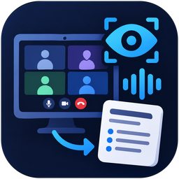
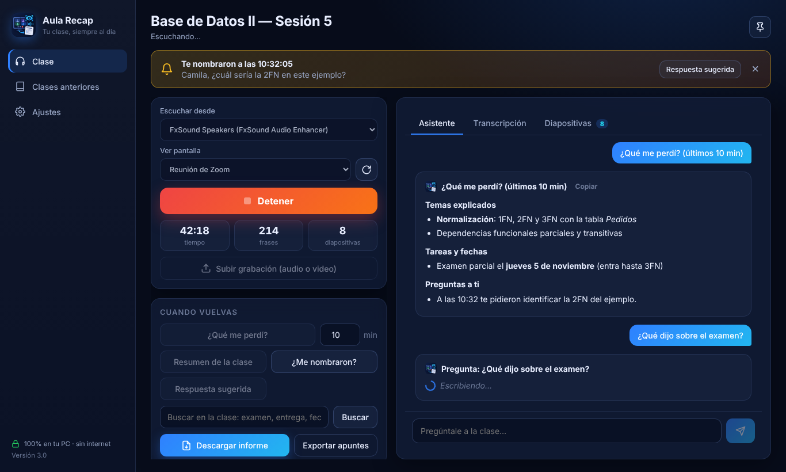
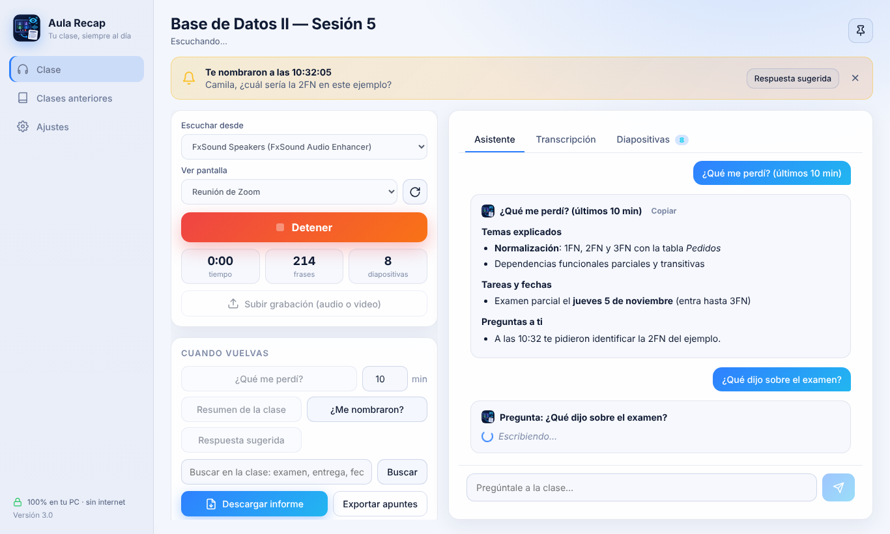
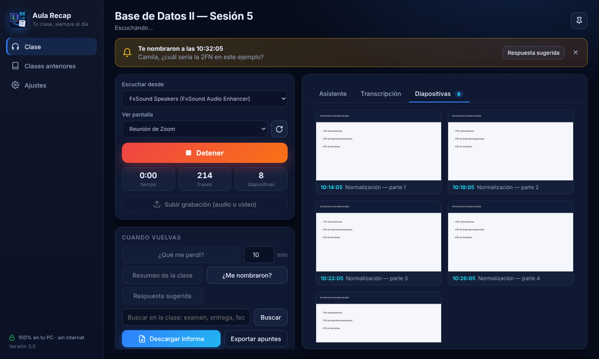
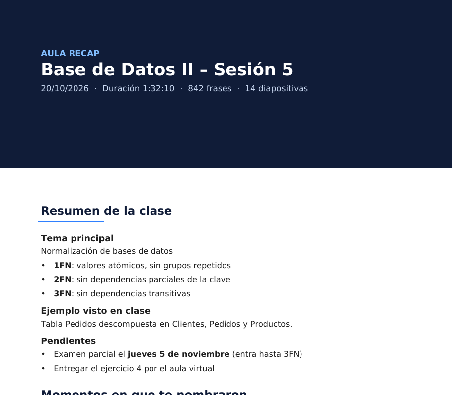
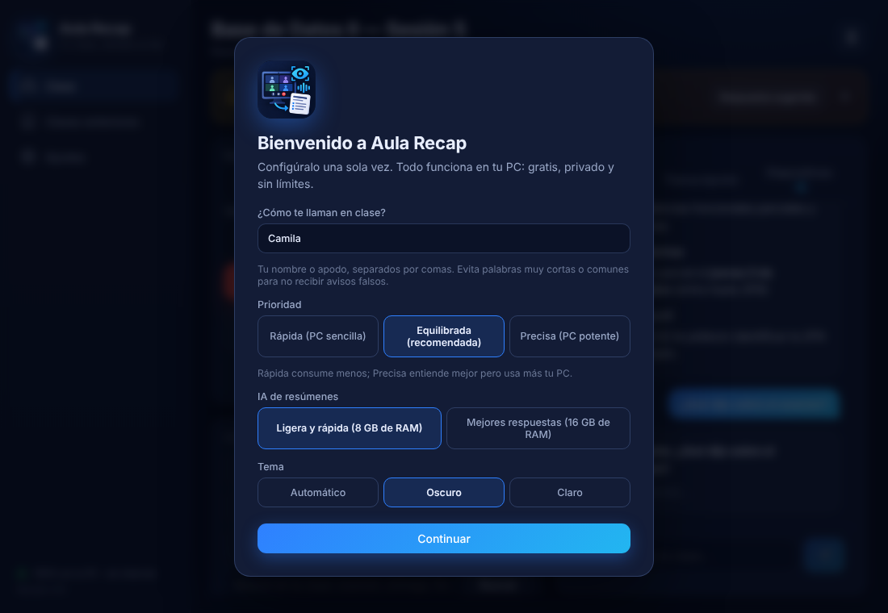
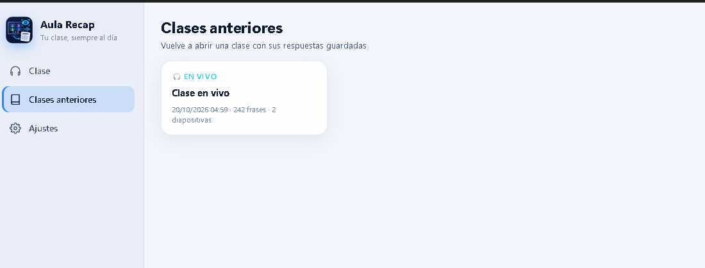
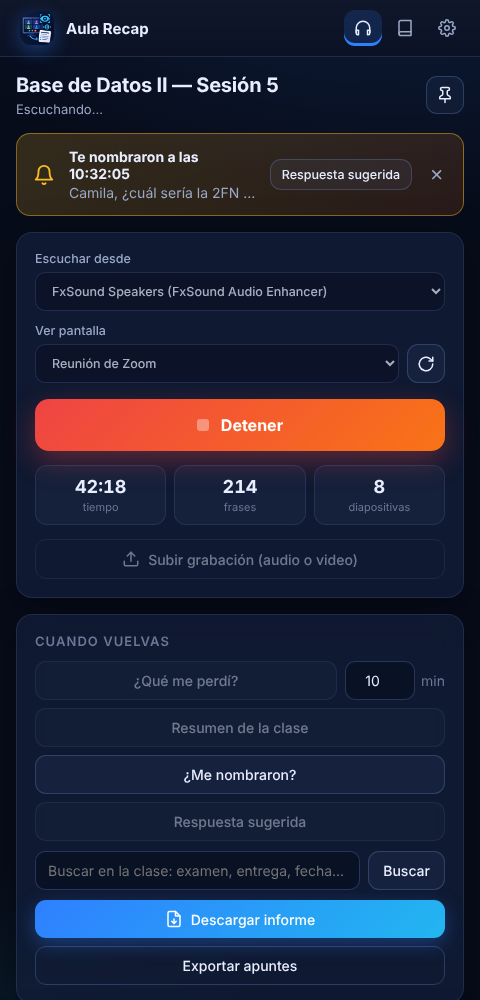

# Aula Recap

**Escucha y mira tu clase virtual mientras no estás, y cuando vuelves te dice lo que te perdiste.**

Gratis · Privado · Sin límites · Funciona sin internet

### [⬇️ Descargar Aula Recap para Windows](https://github.com/junjie1005/AulaRecap-descargas/releases/latest)

---

## ¿Qué es Aula Recap?

¿Te levantaste un momento de tu clase de Zoom y al volver no sabías de qué hablaban? ¿El profe dijo tu nombre justo cuando no estabas?

**Aula Recap escucha la clase y mira las diapositivas por ti.** Cuando vuelves, te resume lo que pasó, te avisa si te nombraron y hasta te sugiere qué responder.

Funciona con **Zoom, Google Meet, Microsoft Teams** y cualquier programa de videollamadas, **incluso con audífonos**. Toda la inteligencia artificial corre **dentro de tu computadora**: no envía nada a internet, no tiene límites de uso y no cuesta nada.

---

## ✨ Funciones

| | Función | Qué hace |
|---|---|---|
| 🎧 | **Escucha la clase** | Transcribe en vivo todo lo que suena en tus audífonos o parlantes. |
| 🖼️ | **Mira la pantalla** | Detecta cada diapositiva nueva, guarda su imagen y lee su texto. |
| 🔔 | **Te avisa si te nombran** | Suena una alerta y la ventana aparece al frente. |
| ⏪ | **¿Qué me perdí?** | Resumen de los últimos minutos que elijas. |
| 📝 | **Resumen de la clase** | Apuntes completos: temas, ejemplos y pendientes (tareas, fechas, exámenes). |
| 💬 | **Respuesta sugerida** | Te dice qué te preguntaron y una respuesta corta para contestar. |
| ❓ | **Pregúntale a la clase** | Escribe cualquier pregunta y responde según lo que se dijo y se mostró. |
| 🔍 | **Buscar** | Encuentra al instante palabras como "examen" o "entrega". |
| 📂 | **Sube grabaciones** | Procesa el audio o video de una clase pasada, mucho más rápido que reproducirlo. |
| 📄 | **Informe en PDF o Word** | Resumen, menciones, preguntas, diapositivas y la transcripción completa en un documento. |
| 📚 | **Clases anteriores** | Vuelve a abrir cualquier clase con todas sus respuestas guardadas. |
| 🌓 | **Tema claro y oscuro** | Diseño moderno que se adapta al tamaño de la ventana. |

---

## 📸 Capturas

<table>
<tr>
<td width="50%">
<b>Tema claro</b>
</td>
<td width="50%">
<b>Diapositivas detectadas automáticamente</b>
</td>
</tr>
<tr>
<td>
<b>Informe en PDF o Word</b>
</td>
<td>
<b>Configuración en 1 minuto</b>
</td>
</tr>
<tr>
<td>
<b>Tus clases guardadas</b>
</td>
<td>
<b>Se adapta a ventanas pequeñas</b>
</td>
</tr>
</table>

---

## 💻 Cómo instalar

1. **Descarga** el archivo `AulaRecap-…-Windows.zip` desde la [página de descargas](https://github.com/junjie1005/AulaRecap-descargas/releases/latest), en la sección **Assets**.
2. **Descomprímelo** (clic derecho → *Extraer todo*) en una carpeta fija, por ejemplo `Documentos\Programas`.
3. Abre la carpeta que se creó y haz doble clic en **`AulaRecap.exe`**.
4. Escribe **cómo te llaman en clase** y pulsa **Continuar**.
5. Espera la **descarga única de la IA** (unos 2.5 GB, con barra de progreso). Después funciona sin internet.
6. Marca **Crear ícono en el escritorio** y pulsa **Empezar**. ¡Listo!

> ⚠️ **¿Windows dice "Windows protegió su PC"?**
> Pulsa **Más información → Ejecutar de todas formas**. Aparece porque el programa aún no tiene una firma digital de pago, no porque sea peligroso.

---

## 🎓 Cómo usarlo

### En una clase en vivo
1. Entra a tu clase de Zoom, Meet o Teams.
2. En **Escuchar desde**, elige tus audífonos (el mismo dispositivo que usa Zoom).
3. En **Ver pantalla**, elige la ventana de la clase. Si no aparece, pulsa ↻.
4. Pulsa **Empezar a escuchar** y haz lo que necesites.
5. Al volver, usa **¿Qué me perdí?**, **Resumen de la clase** o escribe una pregunta.

> No silencies el audio de la clase: Aula Recap escucha lo mismo que tus audífonos.

### Con una clase grabada
1. Pulsa **Subir grabación** y elige el video o audio (mp4, m4a, mp3, wav, webm…).
2. Espera a que llegue al 100%.
3. Pulsa **Resumen de la clase**, **Descargar informe** o escribe una pregunta.

---

## ⚙️ Requisitos

| | Mínimo | Recomendado |
|---|---|---|
| Sistema | Windows 10 de 64 bits | Windows 11 |
| Memoria RAM | 8 GB | 16 GB (para la IA "Mejores respuestas") |
| Espacio en disco | 4 GB libres | 8 GB libres |
| Internet | Solo la primera vez | — |

**¿Cuánto consume?** Mientras escucha, alrededor de 1 a 1.5 GB de RAM. La IA de resúmenes solo se activa al pulsar un botón y se libera sola a los 2 minutos. Si tu PC es sencilla, elige **Prioridad: Rápida** en Ajustes.

---

## 🔒 Privacidad

- **Todo se procesa en tu computadora.** El audio, la pantalla y tus clases nunca se envían a internet.
- **No hay cuentas, publicidad ni rastreo.**
- Tus clases se guardan solo en `Documentos\Apuntes de clase`, y puedes borrarlas cuando quieras.
- La única conexión a internet es la descarga inicial de los modelos de IA.

---

## ❓ Preguntas frecuentes

<b>¿De verdad es gratis y sin límites?</b>

Sí. La IA corre en tu propia PC, así que no hay servidores que pagar ni límites de uso, tiempo o "tokens".

<b>¿Funciona con audífonos?</b>

Sí. Aula Recap escucha lo que sale por el dispositivo que elijas, sean audífonos o parlantes.

<b>¿Funciona con Google Meet, Teams o clases en el navegador?</b>

Sí. Funciona con cualquier programa o página que suene en tu PC. En **Ver pantalla** elige la ventana del navegador o del programa.

<b>¿Por qué la primera vez descarga 2.5 GB?</b>

Son los modelos de inteligencia artificial que hacen la transcripción y los resúmenes. Se descargan una sola vez para que después todo funcione sin internet.

<b>Me avisó que me nombraron, pero no fue así.</b>

En **Ajustes**, escribe solo tu nombre o apodo y evita palabras muy cortas o comunes (por ejemplo, de 3 letras).

<b>Va lento en mi laptop.</b>

En **Ajustes**, cambia **Prioridad** a **Rápida** y la **IA de resúmenes** a **Ligera**. Las respuestas siguen siendo útiles y consume mucho menos.

<b>¿Dónde se guardan mis clases?</b>

En `Documentos\Apuntes de clase`. Cada clase tiene su carpeta con la transcripción, las diapositivas y tus preguntas. También puedes verlas en **Clases anteriores**.

<b>¿Cómo actualizo a una versión nueva?</b>

Descarga la nueva versión, cierra Aula Recap y reemplaza la carpeta del programa. Tus clases, ajustes y modelos de IA se conservan.

<b>¿Cómo lo desinstalo?</b>

Borra la carpeta del programa. Para liberar el espacio de la IA, borra también `C:\Users\TU_USUARIO\AppData\Local\AulaRecap`.

---

## 🤝 Uso responsable

Antes de transcribir o capturar una clase o reunión, revisa las normas de tu institución y, si corresponde, pide permiso al docente o a los participantes. Aula Recap está pensado para **tus apuntes personales**.

---

## 🛠️ Hecho con

[faster-whisper](https://github.com/SYSTRAN/faster-whisper) (transcripción) · [llama.cpp](https://github.com/ggerganov/llama.cpp) (IA local) · [Qwen2.5](https://huggingface.co/Qwen) (modelo de lenguaje) · [pywebview](https://pywebview.flowrl.com/) (interfaz) · OCR de Windows (lectura de diapositivas)

**¿Te sirvió? Dale una ⭐ a este repositorio y compártelo con tus compañeros.**

